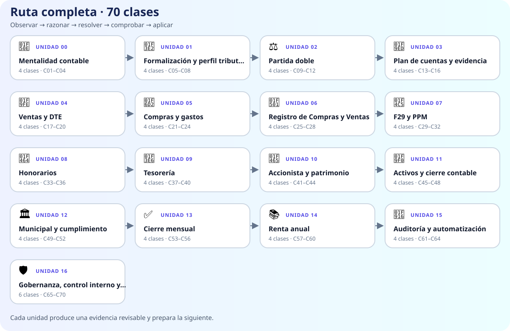

# Currículo completo de Academia

Academia no es una lista de títulos: es una ruta de **70 clases desarrolladas** en 17 unidades. Empieza por reconstruir hechos y documentos, avanza hacia contabilidad e impuestos operativos y termina con automatización, gobierno y control interno.

## Cómo está diseñado el aprendizaje

Cada clase recorre cinco movimientos: **observar → razonar → resolver → comprobar → aplicar**. Antes de avanzar debes producir un entregable que otra persona pueda revisar. El contenido usa una empresa ficticia —Ruta Andina SpA— y se practica en SANDBOX, sin datos personales ni operaciones reales.

| Etapa | Unidades | Qué construyes |
|---|---|---|
| Fundamentos | 00–03 | Lenguaje contable, partida doble, cuentas y trazabilidad |
| Operación | 04–09 | Ventas, compras, RCV, F29, honorarios y relación empresa/propietario |
| Cierre y decisión | 10–14 | Activos, cumplimiento municipal, cierres, caja y renta anual |
| Control | 15–16 | Reglas seguras, automatización, gobierno, riesgo e investigación |

## Las 17 unidades

### 🔎 [Unidad 00 — Mentalidad contable](parts/00-mentalidad-contable/)

Esta unidad cambia la forma de mirar una empresa: primero se reconstruye el hecho y recién después se elige una cuenta o un formulario. Aprenderás a separar lo ocurrido, el documento, el registro y la evidencia.

**Producto de la unidad:** Mapa de un ciclo completo con hechos, documentos, registros, pagos y comprobantes.

**Clases:** C01, C02, C03, C04.

### 🏢 [Unidad 01 — Formalización y perfil tributario](parts/01-formalizacion-y-perfil-tributario/)

Antes de calcular obligaciones hay que saber qué empresa existe, desde cuándo, con qué actividad, domicilio y régimen verificado. La unidad ordena esos hitos sin tratarlos como sinónimos.

**Producto de la unidad:** Ficha maestra de empresa con estados verificados, evidencias y pendientes explícitos.

**Clases:** C05, C06, C07, C08.

### ⚖️ [Unidad 02 — Partida doble](parts/02-partida-doble/)

La partida doble se aprende como una explicación de cambios económicos, no como una receta de Debe y Haber. Cada asiento nace de identificar recursos, obligaciones, resultado y patrimonio.

**Producto de la unidad:** Serie de asientos balanceados con justificación y balance de comprobación revisado.

**Clases:** C09, C10, C11, C12.

### 🧭 [Unidad 03 — Plan de cuentas y evidencia](parts/03-plan-de-cuentas-y-evidencia/)

Transformarás la partida doble en un sistema navegable: plan de cuentas, auxiliares, conciliaciones e identificadores que permiten ir del reporte al documento y volver.

**Producto de la unidad:** Plan de cuentas mínimo y ruta de trazabilidad bidireccional probada.

**Clases:** C13, C14, C15, C16.

### 🧾 [Unidad 04 — Ventas y DTE](parts/04-ventas-y-dte/)

Seguirás una venta desde el servicio y el DTE hasta la cuenta por cobrar, el ajuste y la cobranza. Neto, IVA y total se mantienen separados durante todo el recorrido.

**Producto de la unidad:** Expediente de venta conciliado, con documento, asiento, ajuste y cobranza.

**Clases:** C17, C18, C19, C20.

### 🛒 [Unidad 05 — Compras y gastos](parts/05-compras-y-gastos/)

Analizarás compras y gastos desde la recepción hasta el pago, distinguiendo naturaleza contable, relación con el giro y tratamiento tributario pendiente de verificación.

**Producto de la unidad:** Matriz de compras clasificadas con evidencia, decisión y ruta de consulta.

**Clases:** C21, C22, C23, C24.

### 🔁 [Unidad 06 — Registro de Compras y Ventas](parts/06-registro-de-compras-y-ventas/)

Conciliarás el Registro de Compras y Ventas con los documentos y registros internos, tratando cada diferencia como un hallazgo que debe explicarse.

**Producto de la unidad:** Conciliación RCV con excepciones, responsables, fechas y evidencia de recuperación.

**Clases:** C25, C26, C27, C28.

### 📅 [Unidad 07 — F29 y PPM](parts/07-f29-y-ppm/)

Construirás un control mensual de IVA, PPM y retenciones que explica cada cifra y reconoce cuándo una obligación requiere verificación.

**Producto de la unidad:** Borrador mensual conciliado, rotulado como preparación y acompañado por pendientes.

**Clases:** C29, C30, C31, C32.

### 👤 [Unidad 08 — Honorarios](parts/08-honorarios/)

Recorrerás una prestación independiente desde la boleta hasta el gasto, la retención, el pago líquido y la obligación posterior, sin confundir etiquetas con realidad laboral.

**Producto de la unidad:** Ficha de honorario con cálculo versionado, asiento y evidencia contractual.

**Clases:** C33, C34, C35, C36.

### 🏦 [Unidad 09 — Tesorería](parts/09-tesoreria/)

Administrarás cuenta bancaria, conciliación, cuentas por pagar y flujo de caja como un solo sistema de tesorería. Cada saldo se conectará con vencimientos y evidencia.

**Producto de la unidad:** Tablero de tesorería con conciliación bancaria, vencimientos y flujo de caja por escenarios.

**Clases:** C37, C38, C39, C40.

### 👥 [Unidad 10 — Accionista y patrimonio](parts/10-accionista-y-patrimonio/)

Separarás aportes de capital, préstamos, retiros, pagos personales y cuenta corriente del accionista. Cada transferencia entre propietario y empresa tendrá naturaleza y respaldo.

**Producto de la unidad:** Auxiliar del accionista conciliado con banco, capital, préstamos, retiros y partidas por regularizar.

**Clases:** C41, C42, C43, C44.

### 🧰 [Unidad 11 — Activos y cierre contable](parts/11-activos-y-cierre-contable/)

Estudiarás activos, depreciación, provisiones y cierre de resultados como decisiones documentadas y revisables, no como cifras para cuadrar. Cada ajuste conservará su fundamento.

**Producto de la unidad:** Hoja de activos y ajustes con política, supuestos, aprobación y efecto sobre el cierre.

**Clases:** C45, C46, C47, C48.

### 🏛️ [Unidad 12 — Municipal y cumplimiento](parts/12-municipal-y-compliance/)

Conectarás patente municipal, UTM, contratos y matriz de obligaciones manteniendo visibles comuna, período, frecuencia, fuente y evidencia. También separarás simulación de cálculo verificado.

**Producto de la unidad:** Matriz municipal y contractual con cálculo trazable, calendario y comprobantes requeridos.

**Clases:** C49, C50, C51, C52.

### ✅ [Unidad 13 — Cierre mensual](parts/13-cierre-mensual/)

Aprenderás a cerrar un mes mediante checklists, conciliaciones cruzadas, control de errores y una carpeta de evidencia que otra persona pueda revisar.

**Producto de la unidad:** Carpeta mensual indexada con conciliaciones, excepciones y aprobación de cierre.

**Clases:** C53, C54, C55, C56.

### 📚 [Unidad 14 — Renta anual](parts/14-renta-anual/)

Prepararás la revisión anual conectando doce cierres, régimen verificado, ajustes, registros, declaraciones juradas y F22 sin copiar propuestas a ciegas.

**Producto de la unidad:** Expediente anual conciliado con matriz de aplicabilidad y revisión final.

**Clases:** C57, C58, C59, C60.

### 🤖 [Unidad 15 — Auditoría y automatización](parts/15-auditoria-y-automatizacion/)

Diseñarás automatizaciones que comprueban, alertan y explican, pero se detienen cuando la norma, el dato o la vigencia no están verificados.

**Producto de la unidad:** Regla versionada con prueba, alerta accionable y caso REQUIERE_VERIFICACION.

**Clases:** C61, C62, C63, C64.

### 🛡️ [Unidad 16 — Gobernanza, control interno y auditoría continua](parts/16-gobernanza-control-interno/)

Integrarás gobierno corporativo, segregación de funciones, controles, riesgos, denuncias e investigaciones con independencia y debido proceso. El foco estará en demostrar que cada control realmente operó.

**Producto de la unidad:** Sistema de control interno con RACI, KRI, excepciones e investigación documentada.

**Clases:** C65, C66, C67, C68, C69, C70.

## Cómo recorrerlo sin perderse

1. Lee la introducción de la unidad: allí se explican el propósito, el caso y todo el recorrido.
2. Entra a la primera clase y conserva el entregable antes de marcarla como completada.
3. Usa los enlaces **clase anterior / volver a la unidad / clase siguiente** al inicio y al final de cada clase.
4. Cierra la unidad con el laboratorio del mismo número y usa los casos para integrar varias unidades.
5. Si falta un dato legal o tributario, conserva `REQUIERE_VERIFICACION`: nunca lo reemplaces por cero ni por una suposición.

## Otras formas de estudiar

- [Guía de estudio](../docs/ACADEMIA.md)
- [Laboratorios con pauta y rúbrica](../labs/)
- [Casos integradores](../cases/)
- [Libro completo de Academia en PDF](../docs/ACADEMIA-COMPLETA.pdf)
